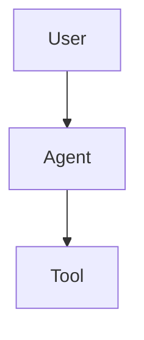

# Sublime Text Markdown Preview Plugin
## Product Requirements Document
### PRD v1.0

---

## 1. 产品定义

### 1.1 产品名称

**Sublime Markdown Preview**

内部 Package ID：

```text
SublimeMarkdownPreview
```

### 1.2 产品定位

一款面向 Sublime Text 4 的轻量级 Markdown 实时预览插件。

核心目标：

> 在 Sublime Text 内完成 Markdown 编辑与实时预览，不依赖外部浏览器。

### 1.3 核心体验

```text
┌──────────────────────────┬──────────────────────────┐
│                          │                          │
│      Markdown Editor     │      Markdown Preview    │
│                          │                          │
│  # Project               │  Project                 │
│                          │                          │
│  ## Architecture         │  Architecture             │
│                          │                          │
│  ```python               │  ┌────────────────────┐  │
│  print("hello")          │  │ print("hello")     │  │
│  ```                     │  └────────────────────┘  │
│                          │                          │
└──────────────────────────┴──────────────────────────┘
```

目标体验接近：

- Obsidian Markdown Preview
- VS Code Markdown Preview
- Typora 的 Markdown 渲染质量

但保持 Sublime Text 的：

- 快速启动
- 低资源占用
- 原生窗口体验
- 键盘操作
- 无 Electron

---

# 2. 产品目标

## 2.1 MVP目标

MVP 必须实现：

1. Markdown 实时渲染
2. Sublime 内部预览
3. 左右分栏
4. 编辑/预览同步滚动
5. GFM
6. 代码高亮
7. 图片
8. 表格
9. Task List
10. 标题目录
11. 暗色/亮色主题
12. 自动刷新
13. 文件保存后自动更新
14. 当前 Markdown 文件绑定预览
15. 多 Markdown 文件独立预览

---

# 3. 非目标

MVP 不做：

- 知识库
- 双向链接
- Graph View
- 数据库
- 云同步
- AI
- Git 管理
- 编辑器替代
- Markdown 所见即所得编辑
- 浏览器插件

插件只解决：

> Markdown → Preview

---

# 4. 支持环境

## 4.1 操作系统

优先：

```text
Windows 10
Windows 11
```

后续：

```text
macOS
Linux
```

## 4.2 Sublime Text

最低：

```text
Sublime Text 4
```

优先支持当前稳定版本。

---

# 5. Markdown 支持

## 5.1 基础 Markdown

必须支持：

```markdown
# Heading

## Heading 2

**bold**

*italic*

~~strike~~

> blockquote

- unordered list
- item

1. ordered list
2. item

[link](https://example.com)


`inline code`

---

# 6. GFM

必须支持 GitHub Flavored Markdown。

### 6.1 Table

```markdown
| Name | Value |
|---|---|
| A | 100 |
| B | 200 |
```

### 6.2 Task List

```markdown
- [x] Done
- [ ] Todo
```

### 6.3 Fenced Code

```markdown
```python
print("hello")
```
```

### 6.4 Strikethrough

```markdown
~~deleted~~
```

---

# 7. 代码高亮

支持常见语言：

```text
Python
JavaScript
TypeScript
JSON
YAML
Bash
Shell
SQL
HTML
CSS
C
C++
Java
Go
Rust
PHP
Markdown
Dockerfile
```

代码块必须显示：

- Syntax Highlight
- 行号（可选）
- Copy Button

---

# 8. 图片

支持：

```markdown

```

相对路径必须相对于当前 Markdown 文件所在目录解析。

支持：

```text
./image.png
../image.png
images/a.png
```

支持：

```text
PNG
JPG
JPEG
GIF
SVG
WEBP
```

图片加载失败时显示明确的错误提示。

---

# 9. 链接

支持：

```markdown
[Google](https://google.com)
```

点击链接：

默认行为：

> 使用系统默认浏览器打开。

内部 Markdown 链接：

```markdown
[Architecture](./architecture.md)
```

点击后：

> 在 Sublime Text 中打开对应 Markdown 文件。

---

# 10. Mermaid

MVP 可选。

如果实现，支持：



目标：

> 在 Preview 中直接渲染 Mermaid。

如果 Mermaid 会显著增加插件体积，则延期到 v1.1。

---

# 11. 数学公式

v1.1 支持：

```markdown
$E=mc^2$
```

以及：

```markdown
$$
E = mc^2
$$
```

推荐：

```text
KaTeX
```

不要求 MathJax。

---

# 12. Preview UI

## 12.1 布局

默认：

```text
Editor | Preview
```

比例：

```text
50% / 50%
```

用户可以拖动分割线调整比例。

---

# 13. Preview 模式

支持三种模式。

### 13.1 Side Preview

```text
Editor | Preview
```

默认模式。

### 13.2 Preview Only

```text
Preview
```

隐藏 Markdown 编辑器。

### 13.3 Editor Only

恢复 Sublime 默认编辑模式。

---

# 14. 实时刷新

编辑 Markdown 后：

```text
Typing
   ↓
Debounce 100~300ms
   ↓
Markdown Parse
   ↓
HTML Render
   ↓
Preview Update
```

不得每次键盘输入都进行完整高成本刷新。

默认：

```text
debounce = 200ms
```

允许用户配置。

---

# 15. Scroll Sync

编辑区与 Preview 必须支持同步滚动。

### Editor → Preview

用户滚动 Markdown：

```text
Editor Position
       ↓
Heading / Block Mapping
       ↓
Preview Position
```

### Preview → Editor

用户滚动 Preview：

```text
Preview Position
       ↓
Markdown Source Position
       ↓
Editor Scroll
```

MVP：

> Editor → Preview 优先。

Preview → Editor 可作为 v1.1。

---

# 16. 标题导航

Preview 顶部提供：

```text
☰ Contents
```

自动生成：

```text
# Project
 ├── Architecture
 ├── Installation
 ├── Configuration
 └── API
```

点击标题：

> Preview 滚动到对应位置。

---

# 17. Front Matter

支持：

```yaml
---
title: My Project
author: Charles
date: 2026-09-09
---
```

Front Matter 默认：

> 不显示在 Preview 正文。

未来可以用于：

- title
- description
- theme
- custom CSS

---

# 18. 主题

默认提供：

```text
Light
Dark
```

自动模式：

```text
Auto
```

Auto：

> 跟随 Sublime Text 当前 Color Scheme。

---

# 19. 自定义 CSS

允许用户：

```text
Preferences
→ Package Settings
→ Sublime Markdown Preview
→ CSS
```

配置：

```json
{
    "custom_css": ""
}
```

或者：

```json
{
    "custom_css_file": ""
}
```

支持用户覆盖：

- font
- font-size
- line-height
- heading
- code block
- table
- image
- blockquote
- link

---

# 20. 命令

提供 Sublime Command Palette：

```text
Markdown Preview: Open Preview
Markdown Preview: Open Preview to Side
Markdown Preview: Toggle Preview
Markdown Preview: Preview Only
Markdown Preview: Refresh
Markdown Preview: Close Preview
Markdown Preview: Open TOC
Markdown Preview: Export HTML
```

---

# 21. 快捷键

默认：

```text
Ctrl + Shift + M
```

打开/关闭 Preview。

可选：

```text
Ctrl + Shift + Alt + M
```

刷新 Preview。

快捷键必须允许用户自定义。

---

# 22. 文件关联

自动识别：

```text
.md
.markdown
.mdown
.mkdn
.mkd
```

仅对 Markdown Syntax 生效。

---

# 23. 多文件

用户可以同时打开：

```text
README.md
PRD.md
ARCHITECTURE.md
CHANGELOG.md
```

每个文件：

> 对应独立 Preview。

切换 Tab：

```text
README.md
     ↓
Preview A

PRD.md
     ↓
Preview B
```

Preview 不得出现内容串台。

---

# 24. 图片路径

Markdown：

```markdown

```

插件必须正确解析：

```text
Markdown File
     ↓
Parent Directory
     ↓
Relative Path
     ↓
Absolute File URI
     ↓
Preview
```

Windows 路径必须正确处理：

```text
C:\project\docs\a.md
```

以及：

```text
C:/project/docs/a.md
```

---

# 25. HTML

支持 Markdown 中的标准 HTML：

```html
<div>
Hello
</div>
```

默认允许：

```text
HTML Block
HTML Inline
```

提供安全配置：

```json
{
    "allow_html": true
}
```

---

# 26. 外部资源

默认：

```text
Local resources: ON
Remote resources: OFF
```

例如：

```markdown

```

默认不自动加载远程资源。

用户可以配置：

```json
{
    "allow_remote_resources": true
}
```

---

# 27. 性能要求

目标：

### 小文件

```text
< 100 KB
```

实时刷新：

```text
< 100ms
```

### 中型文件

```text
100 KB ~ 1 MB
```

刷新：

```text
< 300ms
```

### 大文件

```text
> 1 MB
```

不要求实时逐字刷新。

采用：

```text
Debounce
Incremental Update
Lazy Rendering
```

---

# 28. 资源占用

插件设计原则：

> 不引入完整浏览器。

禁止：

```text
Electron
Chromium Bundle
Node.js Runtime
```

优先：

```text
Sublime API
Python
系统 WebView / Sublime 原生能力
```

目标：

```text
Idle Memory < 50MB
```

不允许后台常驻独立 Server。

---

# 29. 架构

建议：

```text
SublimeMarkdownPreview/
│
├── plugin.py
│
├── commands/
│   ├── open_preview.py
│   ├── close_preview.py
│   ├── refresh_preview.py
│   └── export_html.py
│
├── renderer/
│   ├── markdown.py
│   ├── syntax.py
│   └── sanitizer.py
│
├── preview/
│   ├── manager.py
│   ├── view.py
│   └── sync.py
│
├── assets/
│   ├── preview.css
│   └── theme.css
│
├── settings/
│   └── default.sublime-settings
│
├── Default.sublime-commands
│
├── Main.sublime-menu
│
└── README.md
```

---

# 30. Markdown Engine

优先选择成熟 Markdown parser。

要求：

```text
CommonMark
GFM
Tables
Task Lists
Fenced Code
```

不要自行实现 Markdown parser。

---

# 31. 配置

默认配置：

```json
{
    "preview_mode": "side",
    "split_ratio": 0.5,

    "auto_refresh": true,
    "refresh_delay": 200,

    "sync_scroll": true,

    "theme": "auto",

    "allow_html": true,
    "allow_remote_resources": false,

    "mermaid": false,
    "math": false,

    "code_line_numbers": false,

    "toc": true
}
```

---

# 32. Error Handling

解析失败：

> Preview 不得崩溃。

显示：

```text
Markdown Preview Error

Unable to render document.

[Show Details]
```

图片失败：

```text
Image unavailable
```

插件异常：

> Sublime Text 本身不得退出。

所有异常必须记录到 Sublime Console。

---

# 33. 安全

禁止默认执行任意 JavaScript。

禁止：

```text
<script>
eval()
inline executable JS
```

除非用户明确开启。

远程资源默认关闭。

---

# 34. 导出

v1.0 支持：

```text
Export HTML
```

输出：

```text
document.html
```

HTML 必须包含：

```text
Markdown Content
CSS
Code Highlight
Images
```

v1.1：

```text
PDF
```

---

# 35. 用户体验

打开 Markdown：

```text
README.md
```

用户按：

```text
Ctrl + Shift + M
```

立即得到：

```text
┌────────────────┬────────────────┐
│ Markdown       │ Preview        │
│                │                │
│ # Hello        │ Hello          │
│                │                │
└────────────────┴────────────────┘
```

不得：

- 打开浏览器
- 打开新窗口
- 启动 Node
- 启动独立 Server
- 要求用户配置环境变量

---

# 36. 插件安装

支持：

```text
Package Control
```

安装后立即可用。

不要求：

```text
npm install
pip install
node install
```

---

# 37. MVP验收标准

以下全部通过才算 MVP 完成：

### A. 编辑

- [ ] 打开 `.md`
- [ ] 自动识别 Markdown
- [ ] 正常编辑

### B. Preview

- [ ] Ctrl+Shift+M 打开
- [ ] Sublime 内部显示
- [ ] 左右分栏
- [ ] 实时刷新
- [ ] 不打开浏览器

### C. Markdown

- [ ] Heading
- [ ] Paragraph
- [ ] Bold
- [ ] Italic
- [ ] Link
- [ ] Image
- [ ] List
- [ ] Blockquote
- [ ] Code
- [ ] Table
- [ ] Task List

### D. UX

- [ ] Light Theme
- [ ] Dark Theme
- [ ] Auto Theme
- [ ] Scroll Sync
- [ ] TOC
- [ ] Refresh
- [ ] Close Preview

### E. Stability

- [ ] Windows 11
- [ ] Sublime Text 4
- [ ] 100KB Markdown < 100ms 刷新
- [ ] 1MB Markdown 不崩溃
- [ ] 图片路径正确
- [ ] 中文正常
- [ ] UTF-8 正常

---

# 38. V1.1

第二阶段：

```text
Mermaid
KaTeX
Preview → Editor Scroll Sync
自定义 CSS
HTML Export
PlantUML
Footnotes
Definition Lists
```

---

# 39. V2

暂定：

```text
Markdown Wiki Links

[[Page]]

自动发现 Markdown 文件

文件搜索

Workspace Markdown Navigator

Backlinks

Outline

Graph
```

但 V2 仍然不做完整知识库。

---

# 40. 产品原则

### Principle 1

**Markdown 是一等公民。**

### Principle 2

**Preview 必须在 Sublime 内。**

### Principle 3

**默认零配置。**

### Principle 4

**不依赖浏览器。**

### Principle 5

**不引入 Electron。**

### Principle 6

**不把轻量编辑器变成 IDE。**

### Principle 7

**速度优先于功能数量。**

---

# 41. 最终产品定位

```text
Notepad++
    ↓
传统文本编辑器

Sublime Markdown Preview
    ↓
现代轻量 Markdown 编辑器插件

Obsidian
    ↓
Markdown Knowledge Base

VS Code
    ↓
Full Development Environment
```

Sublime Markdown Preview 的目标不是挑战 Obsidian。

目标是：

> **让 Sublime Text 成为一个真正好用的轻量 Markdown 编辑器。**